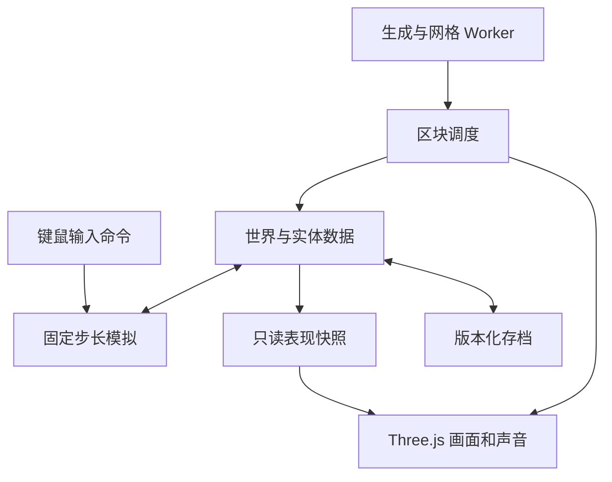

# Veloren 的 Three.js 复刻研究与迭代方案

本项目希望用 Three.js 逐步重建 Veloren 的核心体验，并让每一个关键阶段都能运行、检验和讨论。推进顺序为：底层运行与角色控制、体素世界、移动能力、资源与表现、战斗和成长，最后形成一段完整冒险。

**建议主路线：TypeScript 重建游戏规则，Three.js 负责画面，先交付桌面浏览器单人版本。** 第一项可玩的成果是简化模型构成的底层测试场；第一个完整游戏目标是一段 10—15 分钟的冒险。多人、全世界模拟和大量内容在相应基础验证后进入。

**方案日期：2026 年 11 月 7 日，北京时间。当前状态：静态研究完成，方案待讨论；游戏实现尚未开始。** 文中的浏览器项目区块尺寸、更新频率、地图规模、内容数量和性能预算都是本项目的暂定设计，不是对 Veloren 原作数值的描述，也不是已经测得的结果。

# 一 项目目标和范围

## 用户已明确的要求

- 使用 Three.js，充分研究 Veloren 的源码、资源和玩法。
- 从底层核心逐步实现，每一步都验证，再逐步接入资源与核心玩法。
- 有完整方案与可持续更新的进度 checklist。
- 完成关键步骤后交付可检查的结果，由用户参与讨论做了什么、为什么这样做以及下一步如何推进。

## 本方案采用的工作假设

| 项目 | 建议默认值 | 何时调整 |
| --- | --- | --- |
| 首发试玩环境 | 桌面浏览器，键盘鼠标，第三人称 | P1 前记录用户实际设备；移动端另开适配阶段 |
| 开发路线 | TypeScript 与 Three.js；先单人 | 若多人是第一优先级，在 P3 后提前做双客户端实验 |
| 复刻重点 | 探索、地形尺度、走跳攀爬滑翔、战斗节奏、装备成长 | 用户每次试玩后调整优先级 |
| 世界范围 | 有限地图，按附近区块加载 | 先保证可玩路径，再扩大面积 |
| 代码复用 | 允许研究和有记录的移植；直接派生部分遵守原许可 | 正式发行路线明确时复核 |
| 资源复用 | 逐文件确认来源与许可后导入 | 有限制或来历不明的资源使用替代物 |
| 发布方式 | 可复现的工程与版本化试玩入口 | 公开发布、商业化和商店上线另行确定 |

上述假设属于建议，不记录为用户已经批准的决定。第一版不会承诺整个 Veloren 的内容量、原服务器互通或跨设备完全一致的物理结果。

## 还原度如何判断

| 维度 | 首个完整版本要求 | 后续扩展 |
| --- | --- | --- |
| 规则 | 移动、体力、攻击阶段、受击、掉落、装备和存档形成一致系统 | 更多武器技能、状态效果与数值 |
| 视觉 | 体素地形、人物比例、自然环境、远山层次和第三人称视野可辨识 | 水体、天空、天气、远景与特效 |
| 探索 | 地标引导、不同高差、可选择路径、一次地下城与返回据点 | 多生态、复杂地穴、交通与世界事件 |
| 内容 | 完整的短冒险有起点、挑战、奖励和结束 | 丰富种族、建筑、敌人和装备 |

实现顺序不等于最终重要性。先用简化外观验证规则，后续会专门验收画面与原作体验的接近程度。

# 二 对 Veloren 的理解及证据范围

## 玩法的中心

Veloren 官方定位是开放世界动作冒险 RPG，主要活动包括探索多种环境、使用不同武器战斗、与城镇 NPC 互动和制作装备、进入地下城、采矿，以及多人冒险。适合提炼为本项目的核心循环：**从据点出发，发现地标与资源，经历战斗，获得材料和装备，再以更强的能力探索下一处地点。** 这条循环是本方案基于原作活动作出的归纳。[官方介绍](https://veloren.net/)

官方 FAQ 明确世界是有限的，自由建造不是游戏的主要目标；建造模式与一般 RPG 游玩需要分开看。因此，本轮不把“无限地图”或“随意搭建全部建筑”当成忠实复刻的必要条件。[官方 FAQ](https://book.veloren.net/players/faq.html)

原作已经包含攀爬、游泳、翻滚、滑翔、营火休整、装备、制作与 NPC 互动。它的更新日志还区分了已发布与开发中内容：`0.18.0` 记录于 2026 年 1 月 23 日，包含简单护送与击杀任务、双向 NPC 对话、临时雇佣和飞艇航线；本次快照的 `Unreleased` 另列投递、取回、传话任务。不能沿用旧路线图，把所有任务与交通都说成未来愿景。[固定快照更新日志](https://github.com/veloren/veloren/blob/cd75076cf157d47c97bdf21c5bd7012cc4959dfc/CHANGELOG.md) · [官方玩家指南](https://wiki.veloren.net/wiki/Getting_Started)

## 原作的技术分工

| 原作模块 | 职责 | 对本项目的启发 |
| --- | --- | --- |
| `common` 及其子模块 | 客户端与服务器共用的数据和规则 | 游戏状态独立于画面 |
| `common/state`、`common/systems` | 世界状态、系统更新和物理等共享处理 | 建立明确的更新顺序与规则测试 |
| `world` | 世界生成 | 地形生成独立于渲染，并记录生成器版本 |
| `client` | 通用客户端逻辑 | 输入和状态同步通过边界接入 |
| `server`、`server/agent` | 服务器规则与实体行为 | 后续权威状态与 AI 有明确位置 |
| `voxygen`、`voxygen/anim` | 默认三维前端与动画 | 模型和动作是游戏状态的表现层 |
| `network`、`common/net` | 传输与游戏同步相关代码 | 联网是专门系统，不能由画面库自动补齐 |
| `rtsim` | 世界层面的持续模拟 | 与附近实体的完整模拟分级处理，后期进入 |

模块划分可由官方架构文档与当前公开 `Cargo.toml` 交叉核对；架构文档中也包含未来设想，不能把每一句愿景都当作已完成能力。[架构文档](https://book.veloren.net/contributors/developers/codebase-structure.html) · [工作区配置](https://github.com/veloren/veloren/blob/master/Cargo.toml)

官方说明使用 ECS；公开的 `State` 源码也展示了实体组件、地形、天气、时间和 `tick` 更新入口。我们借鉴这种状态与系统分离的思路，初期只保留少量必要组件，不移植整套 Rust ECS 框架。[ECS 文档](https://book.veloren.net/contributors/developers/ecs.html) · [State 源码](https://docs.veloren.net/src/veloren_common_state/state.rs.html)

## 本轮能确认与尚待确认的边界

- 已阅读官方介绍、技术文档、关键 Rust 源文件与资源许可清单；这是静态研究，不是原游戏运行报告，也不是逐文件审计。
- 官方网站把 GitLab 列为主仓库，把 GitHub 列为镜像。[官方仓库入口](https://veloren.net/joinus/)
- 本轮源码快照固定为 `cd75076cf157d47c97bdf21c5bd7012cc4959dfc`，提交时间为 2026 年 10 月 30 日 08:27，北京时间；对应 tree 为 `418d6a8d401f99d803ca4999c06cc864097f6627`。已通过镜像 API 与该提交下的源码内容核验。这是本次研究基线，不宣称它与当前 GitLab HEAD 完全同步。[提交记录](https://github.com/veloren/veloren/commit/cd75076cf157d47c97bdf21c5bd7012cc4959dfc) · [提交 API](https://api.github.com/repos/veloren/veloren/commits/cd75076cf157d47c97bdf21c5bd7012cc4959dfc)
- 该快照工作区版本字段仍为 `0.18.0`，但同时包含 `Unreleased` 内容；不能把整个主分支快照都称为稳定版 `0.18.0`。本轮没有完整 clone、编译、运行原仓库或批量下载二进制资源。
- 官方 worldgen 文档带有 WIP 标记，可以帮助理解地形、侵蚀、河流和局部细节的层次；本项目不把该文档当作逐行完整的当前生成器规格。[Worldgen 文档](https://book.veloren.net/internals/worldgen/worldgen.html)
- 源码能证明状态与算法存在，移动的主观手感、画面比较和原作参数仍需在固定原作版本上实测。

## 已核验的源码地图

以下源码链接均固定到本轮研究提交。行号可随展示方式变化，文件与符号是主要定位方式。

| 文件与关键符号 | 已确认的机制 | 首次对应阶段 |
| --- | --- | --- |
| [common/state/src/state.rs](https://github.com/veloren/veloren/blob/cd75076cf157d47c97bdf21c5bd7012cc4959dfc/common/state/src/state.rs)，`State::tick` | 共享实体、地形和时间状态；系统分派与维护 | P1 |
| [server-cli/src/main.rs](https://github.com/veloren/veloren/blob/cd75076cf157d47c97bdf21c5bd7012cc4959dfc/server-cli/src/main.rs)，`TPS`；[common/src/clock.rs](https://github.com/veloren/veloren/blob/cd75076cf157d47c97bdf21c5bd7012cc4959dfc/common/src/clock.rs)，`game_dt` | 服务器目标节奏为 30 TPS；实际模拟 dt 经平滑与限制，不是本方案的 60 Hz 固定步长 | P1 |
| [common/src/terrain/mod.rs](https://github.com/veloren/veloren/blob/cd75076cf157d47c97bdf21c5bd7012cc4959dfc/common/src/terrain/mod.rs)，`TerrainChunkSize`；[chonk.rs](https://github.com/veloren/veloren/blob/cd75076cf157d47c97bdf21c5bd7012cc4959dfc/common/src/terrain/chonk.rs)，`Chonk` | 水平 32×32 的区块列，竖向由 32×32×16 子块组织，具有上下默认体素 | P2 |
| [common/systems/src/phys/collision.rs](https://github.com/veloren/veloren/blob/cd75076cf157d47c97bdf21c5bd7012cc4959dfc/common/systems/src/phys/collision.rs)，`box_voxel_collision` | 针对体素的定制碰撞处理与受限增量求解 | P1 至 P2 |
| [voxygen/src/mesh/terrain.rs](https://github.com/veloren/veloren/blob/cd75076cf157d47c97bdf21c5bd7012cc4959dfc/voxygen/src/mesh/terrain.rs)，`generate_mesh` | 可见面、贪心网格、不透明与流体几何分别处理 | P2 |
| [voxygen/src/scene/terrain/mod.rs](https://github.com/veloren/veloren/blob/cd75076cf157d47c97bdf21c5bd7012cc4959dfc/voxygen/src/scene/terrain/mod.rs)，`mesh_worker` | 地形网格在后台任务中生成 | P3 |
| [world/src/lib.rs](https://github.com/veloren/veloren/blob/cd75076cf157d47c97bdf21c5bd7012cc4959dfc/world/src/lib.rs)，`World::generate`、`generate_chunk` | 大尺度世界生成与按需区块生成有独立入口；区块加入洞穴、树木、道路等层 | P3 |
| [voxygen/src/scene/lod.rs](https://github.com/veloren/veloren/blob/cd75076cf157d47c97bdf21c5bd7012cc4959dfc/voxygen/src/scene/lod.rs)，`Lod` | 远景地形和分区物件有独立表现，不是把近景体素无限延伸 | P3 至 P5 |
| [voxygen/src/scene/figure/load.rs](https://github.com/veloren/veloren/blob/cd75076cf157d47c97bdf21c5bd7012cc4959dfc/voxygen/src/scene/figure/load.rs) | VOX 模型索引、部件偏移与配置驱动装配 | P5 |
| [voxygen/anim/src/character/mod.rs](https://github.com/veloren/veloren/blob/cd75076cf157d47c97bdf21c5bd7012cc4959dfc/voxygen/anim/src/character/mod.rs)，`CharacterSkeleton`；[run.rs](https://github.com/veloren/veloren/blob/cd75076cf157d47c97bdf21c5bd7012cc4959dfc/voxygen/anim/src/character/run.rs) | 角色骨架关系和按速度、方向、时间计算的程序化动作 | P5 |
| [common/src/states/basic_melee.rs](https://github.com/veloren/veloren/blob/cd75076cf157d47c97bdf21c5bd7012cc4959dfc/common/src/states/basic_melee.rs)，`StaticData`、`behavior` | 准备、攻击、恢复阶段和 `hit_timing` 命中时机 | P6 |
| [rtsim/src/rule/simulate_npcs.rs](https://github.com/veloren/veloren/blob/cd75076cf157d47c97bdf21c5bd7012cc4959dfc/rtsim/src/rule/simulate_npcs.rs) | 未加载 NPC 的抽象移动；源码仍有重要动作模拟的未完成项 | P10 |

两项不能过度推断：原作有基于 seed 的世界生成，不代表所有动态 NPC 与掉落都能只凭 seed 重放；有 `rtsim` 也不代表完整离线战斗、经济与任务生态均已完成。本项目会单独定义自己的可复现范围。

# 三 技术路线与取舍

## 三种实现方式

| 路线 | 能得到什么 | 主要代价 | 结论 |
| --- | --- | --- | --- |
| A 用 TypeScript 重建核心，Three.js 渲染 | 浏览器中的独立游戏；每一层都便于理解与验证 | 需要重新实现物理、世界与玩法 | 推荐作为主线 |
| B 保留部分 Rust，经 WASM 接到 Three.js | 有机会复用特定算法或数据处理 | 需验证依赖、构建与跨语言数据成本；整库可移植性未验证 | 热点或特定模块证明值得复用后再试 |
| C Three.js 做前端，接原作服务器 | 可能接近原作服务端规则 | 需解决传输、协议、认证、版本与浏览器限制 | 如果目标转为原作网络兼容，再单独论证 |

选择 A 的理由是它最适合“从底层逐步验证、每一步可以讨论”的工作方式。即使将来采用 B，也只替换已经有明确接口和测量依据的模块。

## 首轮技术栈

| 用途 | 选择 | 说明 |
| --- | --- | --- |
| 代码与构建 | TypeScript strict、Vite、锁定依赖版本 | 模块化工程；不做不断膨胀的单文件原型 |
| 渲染 | Three.js `WebGLRenderer`，WebGL 2 | 先建立可复现实验基线 |
| 模拟 | 自有固定步长与少量组件系统 | 不依赖 Three.js 对象作为规则状态 |
| 地形生成与网格 | Web Workers | 输入、规则与 GPU 对象仍在主线程 |
| 角色物理 | 运动学控制器，体素实体查询和碰撞箱 | 验证后再决定是否需要通用物理引擎 |
| 配置 | 经过校验的 JSON 数据 | 从选定 RON 配置做构建期转换，不在浏览器里硬读整库 |
| 存档 | IndexedDB、版本化导入导出 | 地形种子、修改记录与角色状态分别管理 |
| 界面 | 轻量 HTML 与 CSS 叠层 | 技术面板与游戏 HUD 分开 |
| 验证 | Vitest 类规则测试、浏览器操作测试、人工试玩 | 测试围绕实际失败风险，不追求无意义覆盖率 |

WebGLRenderer 当前使用 WebGL 2。WebGPURenderer 提供 WebGPU 与 WebGL 2 回退，但现有自定义材质和后处理不都能原样迁移。因此，WebGPU 保留为后续同场景对照选项，不预先宣称更快或无成本切换。[WebGLRenderer](https://threejs.org/docs/pages/WebGLRenderer.html) · [WebGPU 迁移说明](https://threejs.org/manual/pages/webgpurenderer)

# 四 底层结构和数据流

**规则读取世界数据，画面显示规则结果。** 角色是否撞到墙由碰撞数据决定，攻击是否命中由固定步长中的规则决定；渲染帧率、动画插值或模型加载速度不能改变这些结论。

## 模块责任

| 计划路径 | 责任与关键边界 |
| --- | --- |
| `src/core/` | 时钟、实体 ID、输入命令、状态与规则更新；可在无 WebGL 环境运行 |
| `src/world/` | 体素存储、坐标、材质属性、种子生成、区块生命周期 |
| `src/physics/` | 角色碰撞、地面判断、障碍查询、移动状态 |
| `src/workers/` | 生成与网格任务；不能直接修改主线程状态 |
| `src/render/` | 几何、材质、镜头、光照、环境与 GPU 生命周期 |
| `src/assets/`、`tools/assets/` | 资源清单、构建期转换、运行时装配与缓存 |
| `src/gameplay/` | 战斗、AI、物品、装备、制作、交互和目标 |
| `src/save/` | 存档格式、事务、迁移和恢复 |
| `src/ui/`、`src/debug/` | 游戏 HUD、菜单、诊断面板与验收数据 |
| `tests/`、`docs/` | 可重复样例、阶段记录、决定和出处 |

## 先固定的核心约定

1. **时间。** 暂定每秒 60 次模拟，渲染独立插值；单次画面更新最多补 5 个模拟步，记录丢弃的时间。页面失焦后暂停单人模拟并清空按键；回来时重置时钟，避免瞬移。浏览器绘制回调会随刷新率变化，后台也可能暂停，因此不能按每帧固定移动一段距离。[浏览器动画时钟](https://developer.mozilla.org/en-US/docs/Web/API/Window/requestAnimationFrame)
2. **坐标。** 本项目用 Y 向上、米作为场景单位；体素坐标是整数，实体位置是浮点数。所有模型的轴向、尺度与枢轴转换集中在导入层，不散落在游戏规则里。
3. **区块。** 初始选择 `16×16×16` 的逻辑小块与 `Uint16Array` 材质 ID，材质 0 表示空气；单块 ID 数据为 8 KiB。P3 用相同地图对照 16³ 与 32³ 后记录选择。原作的区块结构以源码为准，不能把本项目尺寸说成原作尺寸。
4. **几何。** 按区块生成外露面 `BufferGeometry`；外露面正确后再加 greedy meshing。重复道具和植被可实例化。地形不按每一个体素建立独立 Mesh。Three.js 官方体素教程明确展示了隐藏面带来的浪费与按相邻体素生成外露面的方式。[体素几何教程](https://threejs.org/manual/pages/voxel-geometry.html) · [BufferGeometry](https://threejs.org/docs/pages/BufferGeometry.html)
5. **异步。** Worker 请求带区块坐标、请求编号、世界世代、数据版本和相关邻居版本；旧结果不得覆盖新世界或新编辑。初期最多 2 个 Worker，队列设上限并按玩家距离排序。
6. **所有权。** 世界体素数据由主线程持有；Worker 接收可丢弃快照，输出可转移网格缓冲。不可把碰撞系统仍在读取的权威缓冲区转走，因为转移后发送端会失去其使用权。[Transferable 说明](https://developer.mozilla.org/en-US/docs/Web/API/Web_Workers_API/Transferable_objects)
7. **加载边界。** 碰撞未就绪的区域是“尚未加载”，不是空气。靠近该边界时限制进入并提示加载，避免角色跌穿。
8. **确定性。** 同一生成器版本和种子的地形应严格复现；同一构建的规则回放要稳定。固定步长不等于已经实现跨浏览器逐位一致，也不构成确定性锁步联网的保证。

# 五 分阶段路线和验收

每个 P 阶段内部可连续完成相关子任务。完成该阶段的测试与试玩包后，状态变为“等待体验”；用户反馈被处理并确认后才记为“已验收”。未通过验收的底层问题不靠增加内容掩盖。

| 阶段 | 交付给用户的东西 | 核心验收 | 当前状态 |
| --- | --- | --- | --- |
| P0 研究与方案 | 原作理解、源码地图、许可结论和路线 | 事实、建议、未知分开，方案可讨论 | 研究初稿完成；待方案讨论 |
| P1 运行核心 | 可走跳的简化测试场与调试面板 | 时间、输入、碰撞和镜头稳定 | 未开始 |
| P2 体素核心 | 有实体碰撞的体素测试世界 | 隐藏面、负坐标、区块接缝、局部重建正确 | 未开始 |
| P3 生成与流式世界 | 可连续行走的山地、河谷、洞穴轮廓 | 同种子复现，异步不过期，卸载不增长 | 未开始 |
| P4 探索移动 | 攀爬、游泳、滑翔与体力路线 | 状态切换与碰撞可靠，移动值得玩 | 未开始 |
| P5 原作资源与画面 | 角色、自然环境、村落与动作样板 | 模型比例、颜色、动画、许可与加载正确 | 未开始 |
| P6 战斗与 AI | 一把剑和一种敌人的可重复对战 | 出招、命中、闪避、受击和死亡形成闭环 | 未开始 |
| P7 交互 成长与完整存档 | 采集、目标、背包、装备、制作和营火 | 状态与奖励一致，刷新可恢复进度 | 未开始 |
| P8 短冒险整合 | 10—15 分钟完整路线 | 玩家可独立完成目标、获得奖励并返回 | 未开始 |
| P9 稳定与交付 | 稳定试玩版、设置、性能报告与说明 | 真实设备体验、保存恢复和回归验证通过 | 未开始 |
| P10 后续扩展 | 多人、世界模拟、更多区域和内容 | 按选定分支另定验收 | 待选择 |

## P0 研究与基线

**交付：** 本方案、来源表、设计选择与开放问题。本轮研究 commit 已固定；实施前检查是否继续沿用该基线，并补充原游戏实机对照与最小资源包。

- [x] 阅读官方玩法定位和有限世界边界。
- [x] 阅读模块结构、ECS 与共享状态源码。
- [x] 核对代码许可和资源许可例外。
- [x] 核对 Three.js 渲染、VOX 解析、Worker 和存档能力。
- [x] 拆分阶段、验收与用户参与方式。
- [x] 固定并核验本轮研究源码快照。
- [ ] 用户讨论并确认首轮范围。
- [ ] 运行选定原作版本，记录移动与画面对照；核验代表资源二进制。
- [ ] 记录第一台基准电脑、GPU、浏览器版本、分辨率。

**讨论点：** 首轮是否采用桌面单人；复刻中探索、动作与画面的优先级；是否需要提前试多人。

## P1 运行核心与测试场

**你能体验：** 用简化角色走动、跳跃、撞墙、穿过窄道、从高台跌落、旋转镜头；打开面板查看速度、落地状态与模拟耗时。

**实现：** 工程入口、固定步长、输入命令、最小状态、运动学角色、障碍查询、第三人称镜头、诊断与输入回放。此时世界由手工碰撞箱组成，P2 再接体素实现。

- [ ] 项目能一条命令启动，生产构建能打开。
- [ ] 建立 60 Hz 模拟、独立渲染和暂停恢复。
- [ ] 键鼠输入支持按下、持续、释放；失焦清空状态。
- [ ] 角色可以行走、跳跃、落地；墙角与头顶碰撞有效。
- [ ] 第三人称镜头随角色运动，并能在障碍前回缩。
- [ ] 提供固定路线回放和调试面板。
- [ ] 同一 600 tick 输入分别在 30、60、144 Hz 渲染调度下完成，最终位置差不超过 0.01 米。
- [ ] 切后台 5 秒后回来不补跑 5 秒、不重复触发跳跃。
- [ ] 用户实际试玩并反馈移动速度、镜头与操作感。

**退出条件：** 关键回放与碰撞场景通过，存在可操作试玩入口和已知问题列表。回退只需返回此前可用提交；此阶段不写用户正式游戏存档。

## P2 体素数据与网格

**你能体验：** 在体素房间与台阶间移动，打开区块线框，修改一处测试方块，查看画面和碰撞如何同步变化。修改功能用于开发验收，不自动扩大为建造玩法。

- [ ] 实现整数体素与区块坐标换算，包含负数。
- [ ] 体素数组、材质实体性和世界查询一致。
- [ ] 外露面网格通过单方块与相邻方块样例。
- [ ] 通过后再合并同材质、同法线且光照属性相容的相邻面。
- [ ] 区块交界面的邻居采样与局部重建正确。
- [ ] 碰撞从体素数据读取，独立于网格生成速度。
- [ ] 区块移除释放几何；共享材质按所有权管理。
- [ ] `x=-1` 映射到区块 -1、局部坐标 15；其他轴同理。
- [ ] 隐藏面阶段单方块 6 面，相邻两方块总共 10 个外露面；空邻居下全实心 16³ 区块为 1536 个外露面。
- [ ] 均匀颜色且均匀光照的实心立方体在 greedy 模式下为 6 个四边形；有不同属性时不错误合并。
- [ ] 用户体验连续跨越区块边界，无裂缝和跌穿。

**退出条件：** 数据、网格、碰撞一致。回退可切换到外露面基础网格，同时保留相同世界数据。

## P3 种子世界与按需加载

**你能体验：** 从谷地走到山坡，经过河流和洞穴入口；输入同一 seed 可回到相同地形；看见附近世界加载、远处区块卸载。

**建议世界：** 首个内容地图水平范围 512×512 米，竖直范围 128 米；按需分配体素小块，不一次加载整个体积。先采用一个山地草原主题，配河流、树林与洞穴。侵蚀模拟、气候经济联动与复杂大陆生成进入后续。

- [ ] 以 seed、生成器版本和全局坐标生成地形。
- [ ] 地标先在低分辨率布局层确定，局部细节按需生成。
- [ ] 相同区块换顺序生成仍得到相同内容哈希。
- [ ] Worker 有请求标识、版本校验、任务队列上限和距离优先级。
- [ ] 新地图或新修改产生后，旧任务结果被丢弃。
- [ ] 玩家附近先保证碰撞，再显示细节；未加载区域有明确处理。
- [ ] 可见半径、预取半径和卸载半径分开，避免边界反复抖动。
- [ ] 世界差异记录独立于已加载区块；卸载表现和碰撞缓存不删除永久修改，后续实体状态沿用该边界。
- [ ] P3 先用有限视距与雾控制成本；P5 补一个由同一高度数据生成的简化远山层，接缝和颜色一致，远景不承担近处碰撞。
- [ ] 先实现基础存档：seed、生成器版本、位置和测试修改记录。
- [ ] 采用相同路线对照 16³ 与 32³ 的网格耗时、提交耗时和绘制数。
- [ ] 连续移动 10 分钟、同一边界往返 20 次，无旧网格覆盖，无持续资源增长。
- [ ] 用户讨论视距、地形尺度、地图边界和探索路线。

**退出条件：** 生成可复现，连续行走可靠，能恢复相同测试世界。回退使用固定小地图或同步生成模式，保存原 seed 与修改记录。

## P4 攀爬 游泳与滑翔

**你能体验：** 走到山脚、攀上高处、滑翔越过谷地，再落入浅水并游回岸边。地图仍可使用简化资源。

- [ ] 地面、空中、攀爬、游泳、滑翔有显式状态与切换条件。
- [ ] 体力消耗与恢复由模拟更新，不受渲染帧率影响。
- [ ] 体力耗尽、落水、撞墙、松开按键与落地都有明确结果。
- [ ] 滑翔具有下沉和速度边界，不产生无限上升。
- [ ] 镜头在高差和狭窄场景中可读，保留灵敏度设置。
- [ ] 同路线能复现状态变化，测试水边与区块边界的组合情况。
- [ ] 用户确认跳跃、攀爬和滑翔是舒适且值得继续打磨的。

**退出条件：** 完整移动路线不用调试指令即可完成。回退通过配置关闭单项新能力，不改世界存档格式。

## P5 资源管线与画面样板

**你能体验：** 测试世界变成一片有角色、树石、村落和光照的体素冒险区域。先比较一个小场景，再批量扩展。

- [ ] 为每个选定资源记录来源路径、参考 commit、哈希、作者、许可和附加条件。
- [ ] 验证一个静态道具、一个角色组合、一个生物组合。
- [ ] 核对 `.vox` 调色板、多模型层级、方向、比例和部件枢轴。
- [ ] 角色部件装配与动作独立实现并验证；以原作 Rust 骨架与动作文件为依据，不把读出模型当成已经得到原作动画。
- [ ] 先完成待机、行走、跳跃、滑翔和受击动作。
- [ ] 建立阳光、环境光、阴影、雾、色彩与水面的最小画面方案。
- [ ] 加入与近景同源的简化远山层，在滑翔路线中验收近远景交接。
- [ ] 不透明地形、水、植被和角色分别控制材质与绘制成本。
- [ ] 资源缺失或加载失败有占位物和可定位错误，不导致整个世界打不开。
- [ ] 小样验收通过后，按需分包；不打包整套原作资产。
- [ ] 用户对比固定机位下的比例、色调、远景和角色辨识度。

**退出条件：** 一组资源可重复导入，角色动作正常，许可记录齐全。回退通过 manifest 切换回占位资源。

## P6 战斗与敌人行为

**你能体验：** 面对一种近战敌人，观察其准备动作，攻击、闪避、被打中、击败敌人或死亡重来。

- [ ] 剑攻击分为准备、有效命中、收招，参数可配置。
- [ ] 生命、体力、受击和闪避状态明确；每次攻击有唯一编号。
- [ ] 命中判定随规则 tick 更新，同一次攻击不会因多帧接触重复扣血。
- [ ] 动画读取攻击阶段；碰撞范围不会仅凭画面中的挥剑效果决定。
- [ ] AI 具备巡逻、发现、追击、出招、恢复、脱离和死亡状态。
- [ ] 敌人能绕开简单障碍；复杂洞穴使用明确的可行路径或路径节点。
- [ ] 敌人不穿墙追击，也不在失去可行路线后瞬移到玩家身边。
- [ ] 生成敌人具有稳定的出生点标识；同一死亡事件只产生一次奖励事件，实际物品入账在 P7 接入。
- [ ] 测试场重置显式创建新的遭遇编号，不把暂停、区块重载或页面刷新当作新击杀。
- [ ] 同一对战输入能回放并核对命中事件。
- [ ] 用户讨论打击反馈、提示是否看得懂、难度和节奏。

**退出条件：** 一场战斗有开始、反应、结果与重试，所有规则能在无渲染环境测试。回退到测试木桩与基础攻击，保留状态接口。

## P7 交互 目标 成长与完整存档

**你能体验：** 接取一个目标，采集材料，领取一次奖励，拾取战利品，打开背包，装备物品，在营火或据点休整，制作一次升级，刷新后继续。

- [ ] 最小通用交互支持距离检查、明确提示和按键触发，覆盖采集点、营火与目标发布者。
- [ ] 采集点有稳定身份、可用与已采集状态，物品入账和节点耗尽一起结算。
- [ ] 目标具有未接取、进行中、可交付、已领取状态；进度来自持久事件或世界状态，不依赖目标实体当前是否加载。
- [ ] 对接取前已获得的材料或已击败的目标，明确读取现有记录的完成规则，避免目标永久无法完成。
- [ ] 用“一处采集点 → 收集材料 → 完成一个目标 → 领取一次奖励”验证系统，再交给 P8 编排完整路线。
- [ ] 物品、堆叠、装备栏和消耗品由数据表定义。
- [ ] 拾取使用唯一对象 ID；背包满时有明确结果。
- [ ] 装备更换真实影响角色属性并反馈到 HUD。
- [ ] 制作检查材料并一次性扣除、发放，不允许重复领取。
- [ ] 营火激活与重生点状态可恢复。
- [ ] 完整存档包含格式版本、生成器版本、seed、世界差异、角色、背包和目标状态。
- [ ] 写入用事务或完整快照切换；中断时仍有上一份完整存档。
- [ ] 导入导出校验版本、字段与文件大小；异常内容不覆盖有效存档。
- [ ] 至少一个旧版迁移样例通过，生成算法变化不得悄悄改变旧世界。
- [ ] 完成组合验收：击败或采集 → 卸载区块 → 返回 → 保存重载 → 死亡重试，核对实体、目标、物品和奖励次数。
- [ ] 用户反馈背包、制作和存档的使用成本。

### 首个短冒险的恢复规则

以下是本项目为验证闭环选择的暂定规则，不描述原作的重生机制。稳定对象标识由存档中的世界 ID、固定出生点或采集点标识组成；运行时实体 ID 与永久对象身份分开。奖励和掉落另带唯一事件编号。

| 对象 | 离开区块与读档 | 玩家死亡 | 允许重置的时机 |
| --- | --- | --- | --- |
| 敌人 | 已击败者保持死亡；未击败者重新加载时回到出生点并恢复生命，不保存逐帧 AI 状态 | 不复活已击败敌人；存活敌人脱战回出生点 | 显式开始新冒险；后续若增加刷怪，另定重生规则与遭遇编号 |
| 采集点 | 已采集状态保留，不因卸载或刷新补货 | 保留采集状态 | 显式开始新冒险 |
| 地面掉落 | 未拾取者按 ID、物品与位置保存；已拾取者不重建 | 地面掉落保留，玩家背包保留 | 拾取后移除，或开始新冒险；首切片不做自动过期 |
| 一次性目标奖励 | 目标领取记录与物品入账同一事务提交，反复交互不重复领取 | 保留目标进度和领取状态 | 新冒险使用新的世界与目标记录 |
| 玩家 | 保存位置、属性、背包与激活营火 | 回到激活营火并恢复生命与体力；首切片不增加掉装备惩罚 | 玩家主动选择新冒险；必须明确不会修改原有存档 |

测试场可以显式重置遭遇来反复验证战斗；这不等于正式世界会在重载时刷新奖励。P8 可以调整死亡代价或资源重生设计，但必须同时更新存档字段和组合验收。

**退出条件：** 交互、目标、获得、消耗、装备、保存和恢复一致。升级前保留存档备份；旧版本不写新版本存档。

## P8 10 到 15 分钟的短冒险

这是为验证系统而设计的项目内容，不声称是对原作某条任务的逐字复刻。

| 顺序 | 玩家经历 | 验证系统 |
| --- | --- | --- |
| 1 | 在小村庄或营地出生，获得清晰目标 | HUD、交互、目标状态 |
| 2 | 沿地标走入河谷与山坡，采集少量材料 | 生成、流式加载、资源交互 |
| 3 | 攀爬至观察点，再滑翔或步行选择路径 | 移动、体力、镜头与路线设计 |
| 4 | 遭遇普通敌人，学会识别攻击提示 | AI、战斗、受击与掉落 |
| 5 | 进入一个小洞窟或遗迹，挑战强化敌人 | 室内外过渡、场景路径与奖励 |
| 6 | 回到营火，装备或制作升级并保存 | 成长、恢复与完整循环 |

**内容上限：** 1 个主要生态，1 个小聚落，1 个洞窟或遗迹，3 类敌人以内，2 类武器以内，约 6 件装备与 3 个配方，1 条目标链。数量是控制工作量的起始上限；战斗一项不成立时，先修正而不增加敌人数。

- [ ] 全路线无需开发者现场解释即可完成。
- [ ] 出发前知道目标，途中知道方向，结束后知道获得了什么。
- [ ] 所需交互、移动与战斗均来自已有真实系统。
- [ ] 操作提示、目标、物品、营火与关键战斗反馈使用中文，文字清楚且与实际按键一致。
- [ ] 失败可以恢复，错过物品不会导致不可完成的流程。
- [ ] 一次中途退出再进入，仍能完成路线。
- [ ] 用户完成整段冒险，并决定下一轮更重视探索、战斗还是内容。

**退出条件：** 不依靠调试按钮或临时脚本完成整个循环。回退保留已经验证的系统，缩减路线或内容数量。

## P9 稳定性与可复现交付

- [ ] 在约定真实设备上记录冷启动和预热后性能。
- [ ] 验证 20 分钟游玩，记录卡顿、报错、队列与资源数量。
- [ ] 帧率变化、窗口缩放、失焦、音频启动、鼠标锁定与退出正常。
- [ ] 提供音量、画质、视距、镜头灵敏度和运动模糊等适用设置；未实现的效果不展示空开关。
- [ ] 保存失败提示清楚，并提供导出备份。
- [ ] 对最重要的移动、跨区块、战斗和存档路径做回归验证。
- [ ] 核验目标浏览器；尚未验证的 Safari、Firefox 或手机不列为已支持。
- [ ] 发布包包含版本信息、构建说明、已知问题、代码与资源出处。
- [ ] 用户完成版本验收。

**退出条件：** 可以由另一人按说明运行，关键体验与存档可靠，性能结论对应具体设备和设置。

## P10 后续扩展的进入条件

| 分支 | 先做的小实验 | 进入条件 |
| --- | --- | --- |
| 多人 | 两客户端、一个权威服务器、小地图与一种交互 | 移动、序列化状态和命令边界稳定；若多人是核心，提前到 P3 后 |
| 原作网络兼容 | 只读连接或受控同步实验 | 核验原作实际协议、传输与认证；不得假定原服务器支持浏览器 WebSocket |
| 世界持续模拟 | 远处 NPC 的简化状态与近处完整状态切换 | 单人基本循环已成立，且 NPC 活动确实能改善体验 |
| 视觉扩展 | 一组场景 A/B 对照 | 有性能余量；再评估 WebGPU、复杂水体或天空 |
| 内容扩展 | 一种新生态或一种新武器 | 原有管线能稳定添加内容，不要求改底层 |
| 骑乘与伙伴 | 一只可跟随、可交互生物 | AI、实体碰撞和存档已稳定 |
| 移动端 | 同一测试场的触控与性能实验 | 单独确认设备与操作需求 |

多人主线如果被提前选中，应在大量内容生产前完成权威服务器与客户端预测的验证；不等所有单人内容做完后才改数据流。

# 六 第一阶段的可执行任务

**目标：** 构建可走跳、可碰撞、可观察状态的核心测试场。

**架构：** 无渲染依赖的模拟内核接受按 tick 编号的输入命令；Three.js 读取快照显示角色和测试地形。手工碰撞箱通过统一接口查询，为 P2 体素碰撞留出替换位置。

**约束：** TypeScript strict；Y 向上；60 Hz 模拟；最多补 5 步；输入单帧间隔上限 0.25 秒；每个重要规则先建立能发现错误的最小样例。此节是 P1 的实施提案；其余阶段在前一阶段结果出来后再展开到同等粒度。

## Task 1 工程与时钟

**计划文件：** `package.json`、`tsconfig.json`、`vite.config.ts`、`src/main.ts`、`src/core/FixedStepClock.ts`、`tests/core/fixed-step.test.ts`。

**接口：** `advance(deltaSeconds, step)` 返回本次步数、插值系数与丢弃时间；`reset()` 清空时间积累。具体返回类型写入 `src/core/types.ts`。

- [ ] 创建最小工程、依赖锁文件与 `dev`、`build`、`test` 命令。
- [ ] 写时钟测试：10 秒分别用 30、60、144 Hz 帧间隔驱动，应执行 600 次模拟更新；1 秒异常间隔单次最多执行 5 步。
- [ ] 先运行样例确认它能发现缺失或错误实现。
- [ ] 实现时钟和暂停重置；再次验证时钟样例。
- [ ] 构建并打开页面，面板显示模拟次数与渲染次数。
- [ ] 保存一次可回退提交及结果记录。

## Task 2 输入与无画面模拟

**计划文件：** `src/core/types.ts`、`src/core/Simulation.ts`、`src/input/InputController.ts`、`tests/core/input-replay.test.ts`。

**接口：** `InputCommand` 包含 `tick`、`sequence`、平面移动方向、朝向与按键事件；`Simulation.step(command, dt)` 更新纯数据；`snapshot()` 输出表现需要的只读状态。连续按键与一次性按下事件分开。

- [ ] 写输入回放样例：一个跳跃按下事件跨多个补偿 tick 只触发一次；失焦后不残留前进输入。
- [ ] 实现输入采集与固定 tick 消费，不在绘制回调里修改角色位置。
- [ ] 实现最小模拟状态和可重放命令序列。
- [ ] 用相同 600 tick 命令验证 30、60、144 Hz 调度的最终位置误差不超过 0.01 米。
- [ ] 记录命令样本与可回退提交。

## Task 3 碰撞和测试场

**计划文件：** `src/physics/CollisionWorld.ts`、`src/physics/KinematicCharacter.ts`、`src/physics/FixtureCollisionWorld.ts`、`src/scenes/CoreTestScene.ts`、`tests/physics/character.test.ts`。

**接口：** `CollisionWorld.querySolidBoxes(bounds)` 返回附近实体碰撞箱；`isRegionReady(bounds)` 表示区域能否安全进入。控制器只依赖该接口，不依赖场景 Mesh。

**初始选择：** 先用轴对齐角色碰撞箱完成地面、墙角、跳跃与头顶校验；通过手感验收后再决定是否替换为胶囊体。高速运动采用扫掠或明确受限子步进，并固定最大速度测试。

- [ ] 建立平地、墙角、窄道、低顶、台阶和高台场景。
- [ ] 写场景行为断言：接地稳定、不能穿墙、头顶碰撞后停止向上、未知区域不能跌入。
- [ ] 实现移动、重力、跳跃和碰撞修正。
- [ ] 运行正常速度和约定最大速度下的场景样例。
- [ ] 接入灰盒角色表现，并保存可回退提交。

## Task 4 镜头 诊断与试玩

**计划文件：** `src/render/Renderer.ts`、`src/render/ThirdPersonCamera.ts`、`src/debug/DebugPanel.ts`、`src/debug/BenchmarkRecorder.ts`、`tests/e2e/core-scene.spec.ts`、`docs/reviews/P01.md`。

**接口：** 渲染器消费 `Simulation.snapshot()`；镜头以角色表现位置为目标，障碍回缩查询使用同一碰撞世界。诊断导出包含版本、浏览器、设置、帧耗时与模拟计数。

- [ ] 实现第三人称转向、跟随、插值和墙前回缩。
- [ ] 面板显示位置、速度、接地状态、frame time 与 simulation time。
- [ ] 验证窗口缩放、点击进入控制、Esc 退出、失焦和恢复。
- [ ] 执行构建、规则测试和关键浏览器操作路线，记录实际结果。
- [ ] 准备试玩入口、操作说明、已知问题与本次改动讲解。
- [ ] 进入 P1 等待体验状态，处理用户反馈；不自动开始 P2。

P1 的五项重点风险分别归属于上述任务：时钟追帧失控归 Task 1；输入事件重复或失焦残留归 Task 2；墙角、高速及未加载区域归 Task 3；镜头与控制状态归 Task 4；帧率改变规则由 Task 1 与 Task 2 的同一输入回放共同验证。

# 七 资源复用与许可策略

原作工作区声明 `GPL-3.0-or-later`。对直接复制或移植形成的受 GPL 覆盖代码，分发时需要按适用条款保留许可与修改声明，并提供相应源码等材料。把 Rust 翻译成 TypeScript 不会自动解除这类许可义务。单纯借鉴概念与直接改写受保护代码应分开记录，不能仅凭“参考过源码”就断言所有独立代码自动使用同一许可。[工作区许可](https://github.com/veloren/veloren/blob/cd75076cf157d47c97bdf21c5bd7012cc4959dfc/Cargo.toml) · [GPL 原文](https://github.com/veloren/veloren/blob/cd75076cf157d47c97bdf21c5bd7012cc4959dfc/LICENSE) · [FSF 关于语言翻译的说明](https://www.fsf.org/blogs/licensing/recent-licensing-updates)

`assets/credits.ron` 中存在单独许可条目，包括部分音乐与模型的 `CC-BY-NC-SA 4.0`，一些音乐另列使用限制，字体也有不同许可。因此资源按文件核验；初期排除额外限制未解决的条目，使用原创或许可适合的替代物。正式对外分发前复核最终实际打包内容。[资源许可清单](https://github.com/veloren/veloren/blob/master/assets/credits.ron)

## 每个资源的记录

| 字段 | 作用 |
| --- | --- |
| `assetId` | 浏览器游戏内稳定 ID |
| `sourceRepository`、`sourceCommit`、`sourcePath` | 可追溯原始出处 |
| `sourceHash`、`outputHash` | 确认导入版本与转换结果 |
| `authors`、`license`、`licenseNotes` | 保存作者、条款与例外 |
| `conversionVersion` | 重现转换过程 |
| `units`、`axisTransform`、`pivot` | 确保装配与尺度一致 |
| `approvalStatus` | 允许导入、待核验或排除；构建只接受已核验资源 |

Three.js 的 VOXLoader 当前可解析 VOX 并返回 `chunks` 与 `scene`；角色装配、动作与原作数据定义仍要独立验证。原作角色的头、胸、手脚、装备与滑翔翼分别装配，骨架和动作由 Rust 代码组织。因此先重建有限状态的部件动画，不计划首轮完成全动画自动翻译器。小样通过前不承诺整套资源自动转换。[VOXLoader](https://threejs.org/docs/pages/VOXLoader.html) · [原作骨架源码](https://github.com/veloren/veloren/blob/cd75076cf157d47c97bdf21c5bd7012cc4959dfc/voxygen/anim/src/character/mod.rs)

多模型 VOX 还涉及零起算模型索引、部件偏移、物品图像变换及有语义的调色板槽位；地形方块与角色细体素采用不同尺度。这些信息进入转换规则与代表样例，不依靠肉眼缩放每个文件。[多模型指南](https://book.veloren.net/contributors/guides/multiple-models/guide.html) · [盔甲指南](https://book.veloren.net/contributors/guides/adding-armor/guide.html) · [体素美术指南](https://book.veloren.net/contributors/artists/voxel-models.html)

资源管线按“选定资源与记录出处 → 转换和校验 → 运行时 manifest → 小场景验收 → 分包扩展”推进。演示中标注参考来源，项目名称与界面不使人误认为官方浏览器版。

# 八 存档与版本策略

存档保存世界与玩法数据，不保存 Three.js 场景对象。推荐最小结构包括：格式版本、生成器版本、项目构建版本、seed、玩家状态、已改变的体素或交互对象、物品与目标状态。P3 验证基础格式，P7 补全玩法与迁移。

IndexedDB 提供结构化数据和事务接口，适合这类异步存储；浏览器持久化请求可能不被批准，因此仍需导出备份。[IndexedDB](https://developer.mozilla.org/en-US/docs/Web/API/IndexedDB_API) · [持久化请求](https://developer.mozilla.org/en-US/docs/Web/API/StorageManager/persist)

- 游戏版本标签建议为 `p01-core`、`p02-voxel` 等；每次试玩另记录实际 commit。
- 每个阶段保留上一版可运行成果。
- 世界生成器改变时，选择保留旧生成器、迁移完整地形，或明确开新世界，不能默认拿旧 seed 配新算法。
- 回退代码前先复制存档；旧版本不得覆盖它不能理解的新格式。
- 原作参考版本、项目版本、资源版本和存档版本分别记录。

# 九 性能预算与验证方式

**以下是待实测校准的起始预算，不是性能承诺。** P1 记录用户实际硬件后再冻结基准。建议测试条件为桌面浏览器、1920×1080、DPR 1、固定画质、固定 seed 和固定移动路线；P3 分别保留冷启动与预热数据。

| 指标 | 暂定起始目标 | 如何判断 |
| --- | --- | --- |
| 帧时间 | 目标 60 FPS；预热后 p95 ≤20 ms，p99 ≤33 ms | 固定 5 分钟路线；记录卡顿分布而非只看平均值 |
| 规则更新 | 每个模拟步 p95 ≤3 ms | 单独计时移动、AI 和战斗 |
| 主线程网格提交 | 每帧预算约 2 ms | 超额排队，不集中上传 |
| 绘制规模 | 基准视野暂以 ≤300 次绘制、≤50 万三角形为起点 | 阴影与额外 pass 一并计入并说明 |
| CPU 缓冲与 GPU 资源估算 | 可计量部分暂以 ≤256 MiB 为起点 | CPU 数组按 byteLength；GPU 按几何和纹理估算 |
| 生命周期 | 同一边界往返 20 次后不持续增长 | 比较预热后的相同位置，允许有界缓存 |
| 错误 | 关键路线无未处理异常、无未知区域跌穿 | 错误记录与人工试玩交叉核对 |

预算超出时，先区分生成、网格化、上传、绘制调用、阴影、透明材质和像素填充的成本，再决定优化。几何数量统计不是显存字节数；CPU 和 GPU 时间也不能简单相加当作精确总帧耗时。

**三类证据要同时具备：** 纯数据规则测试用于坐标、回放、战斗和存档；浏览器运行验证用于输入、加载与资源；用户试玩用于镜头、节奏和还原度。只有截图不能证明底层正确，只有测试通过也不能证明好玩。

# 十 用户如何参与每次迭代

用户主要决定体验与范围，我负责把实现与证据解释清楚。用户不需要替代自动化测试，也不需要在看见效果前决定所有函数设计。

每个关键阶段交付相同的七项内容：

1. **版本和入口：** 哪一个版本，在哪里试玩，如何回到上一版。
2. **这次能做什么：** 用玩家语言描述新增能力。
3. **做了什么和怎么做：** 改了哪些核心模块，一张小图或一个例子解释关键机制。
4. **原作对应位置：** 参考的文件或玩法，以及这次主动简化的部分。
5. **验证结果：** 实际运行的样例、通过和失败项、性能条件。
6. **已知问题：** 哪些影响试玩，哪些安排后续处理。
7. **下一步：** 只提议紧接着的一阶段，并列出需要用户判断的体验取舍。

例如 P2 讨论时，可以在同一场景切换“全部立方体面”和“只生成外露面”，同时看三角形数量；P4 讨论时，可以对比两组滑翔下降速度；P6 可以慢放一次攻击的准备、命中与收招阶段。

## 阶段状态的含义

| 状态 | 含义 |
| --- | --- |
| 未开始 | 只有计划，没有实现 |
| 开发中 | 正在修改，尚无可验收版本 |
| 技术验证通过 | 本阶段必要样例通过，结果有记录 |
| 等待体验 | 已提供可操作版本，等待用户试玩与讨论 |
| 需调整 | 反馈或测试发现必须修正的问题 |
| 已验收 | 技术验证与用户体验反馈均已处理 |
| 延后 | 明确不属于当前阶段，保留进入条件 |

记录技术验证与用户验收两个结果，不用“写完代码”替代“完成阶段”。同一阶段内的常规修复连续推进；到约定体验节点再暂停讨论。

# 十一 当前进度总清单

- [x] 原作玩法与整体架构研究初稿。
- [x] 源码、资源与浏览器能力的关键约束整理。
- [x] 分阶段路线、完成条件和用户参与机制。
- [x] P1 的任务分解和验证样例。
- [x] 本轮源码基线 `cd75076c` 与关键文件对应关系。
- [ ] 用户讨论方案与首轮默认假设。
- [ ] 原作实机体验、对照素材与代表资源导入验证。
- [ ] P1 运行核心与测试场。
- [ ] P2 体素数据、网格与碰撞。
- [ ] P3 种子生成、Worker、加载卸载与基础存档。
- [ ] P4 攀爬、游泳、滑翔和体力。
- [ ] P5 资源导入、角色装配与画面样板。
- [ ] P6 战斗和敌人行为。
- [ ] P7 交互、采集、目标、物品、制作与完整存档。
- [ ] P8 完整短冒险。
- [ ] P9 稳定性与交付验收。
- [ ] P10 按反馈选择后续分支。

**最近一次已完成工作：** 原作静态研究与本版方案。

**下一项建议：** 完成方案讨论与基准记录后，仅执行 P1，交付能走、能跳、能碰撞、能查看状态的测试场，然后停在体验讨论点。

**排期原则：** 目前按可验收成果排序，不承诺完整复刻需要多少天。P1 结束后根据真实实现和反馈成本估算 P2—P3；每阶段结束重新估算下一阶段。

# 十二 主要一手资料

| 资料 | 本方案使用范围 |
| --- | --- |
| [Veloren 官网](https://veloren.net/) | 玩法与产品定位 |
| [官方仓库入口](https://veloren.net/joinus/) | GitLab 主仓库与 GitHub 镜像关系 |
| [工作区配置](https://github.com/veloren/veloren/blob/master/Cargo.toml) | 模块、版本字段与代码许可 |
| [官方架构文档](https://book.veloren.net/contributors/developers/codebase-structure.html) | 前后端与共享模块边界 |
| [ECS 文档](https://book.veloren.net/contributors/developers/ecs.html) | 实体、组件和系统设计 |
| [State 源码](https://docs.veloren.net/src/veloren_common_state/state.rs.html) | 状态、地形变更与 tick |
| [Worldgen 文档](https://book.veloren.net/internals/worldgen/worldgen.html) | 世界生成层次，保留 WIP 限定 |
| [官方 FAQ](https://book.veloren.net/players/faq.html) | 有限世界与建造边界 |
| [LICENSE](https://github.com/veloren/veloren/blob/master/LICENSE) | GPL 条款原文 |
| [资源 credits](https://github.com/veloren/veloren/blob/master/assets/credits.ron) | 资源作者、许可和附加条件 |
| [Three.js WebGLRenderer](https://threejs.org/docs/pages/WebGLRenderer.html) | 渲染基线 |
| [Three.js WebGPU 说明](https://threejs.org/manual/pages/webgpurenderer) | 后续迁移取舍 |
| [Three.js 体素教程](https://threejs.org/manual/pages/voxel-geometry.html) | 外露面、分块几何 |
| [Three.js VOXLoader](https://threejs.org/docs/pages/VOXLoader.html) | VOX 解析入口 |
| [MDN Worker 缓冲转移](https://developer.mozilla.org/en-US/docs/Web/API/Web_Workers_API/Transferable_objects) | 数据所有权 |
| [MDN IndexedDB](https://developer.mozilla.org/en-US/docs/Web/API/IndexedDB_API) | 存档接口与事务 |
| [FSF 语言翻译说明](https://www.fsf.org/blogs/licensing/recent-licensing-updates) | 移植代码的许可边界 |

关键源码已在前文使用固定 commit 链接；在线文档、主分支索引与实际实施基线仍应核对差异。任何未实测的性能或兼容性，均不记入已完成进度。